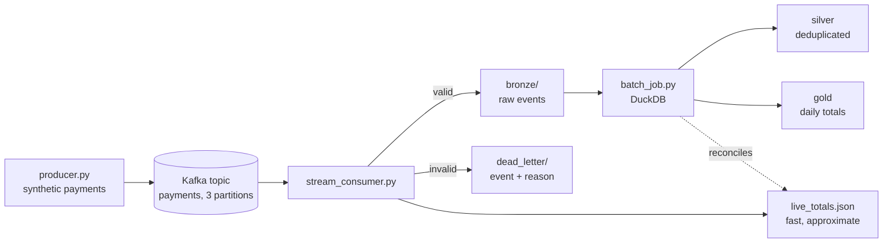

# Payments stream + batch POC

[](https://github.com/KokYenZein/payments-stream-batch-poc/actions/workflows/ci.yml)

A small proof of concept I built to test one idea: a streaming path and a batch path can share the same event log, with the stream giving a fast answer and the batch giving the correct one.

I have not run Kafka in production. This is how I checked my understanding of it before writing about it.

Everything here is synthetic. No employer or customer data is involved.

## What it does



| File | Role |
| --- | --- |
| `producer.py` | Sends about 2,000 payment events to Kafka. Around 3% are sent twice, 2% are dated one or two days late and 1% are invalid. |
| `stream_consumer.py` | Reads events as they arrive, validates them, lands them in `bronze/`, and keeps running totals per merchant category. |
| `batch_job.py` | Rebuilds clean tables from `bronze/` with DuckDB, runs data quality checks, and compares its totals with the stream's. |
| `config.py` | Topic name, paths and other shared settings. Anything that differs between machines is read from environment variables. |
| `test_validate.py` | Unit tests for the validation rules. |
| `check_e2e.py` | End-to-end check of the numbers after a run. |

## Run it

You need Docker and Python 3.9+.

```bash
docker compose up -d                      # start a single-node kafka
python -m venv .venv && source .venv/bin/activate
pip install -r requirements.txt

python stream_consumer.py                 # terminal 1, leave it running
python producer.py                        # terminal 2
python batch_job.py                       # terminal 2, after the producer finishes
```

To see what a crash looks like, stop the consumer with Ctrl+C and make it read the whole topic again under a new consumer group:

```bash
CONSUMER_GROUP=replay-after-crash python stream_consumer.py --exit-when-idle 10
python batch_job.py
```

The stream's live totals roughly double. The batch output does not change.

## What to look at

The producer prints what it injected, and the batch job should account for all of it:

```
sent 2051 messages to topic 'payments'
  unique valid events : 1980 (of which late: 41)
  duplicate sends     : 51
  bad events          : 20
```

```
== batch run ==
bronze rows read        : 2031
duplicates removed      : 51
silver rows written     : 1980
late events re-dated    : 41
dead letters (rejected) : 20

== data quality checks ==
PASS  event_id is unique
PASS  no missing keys
PASS  amounts are positive
PASS  gold adds up to silver

== stream vs batch ==
category      stream   batch  extra  amount drift
bills            390     380     10       2773.57
dining           390     383      7       1826.38
...
```

## How it is tested

Every push runs two jobs in GitHub Actions (`.github/workflows/ci.yml`):

1. **Unit tests** for the validation rules (`pytest`).
2. **End to end against a real Kafka broker.** The workflow starts Kafka, runs the producer, the stream consumer and the batch job, and `check_e2e.py` compares the result with what the producer injected. It then replays the whole topic to simulate a crash, reruns the batch job, and checks that the batch tables are unchanged.

The run summary shows the batch report, and the output tables are attached to the run as an artifact.

To run the same checks locally:

```bash
pip install pytest && pytest -q
python check_e2e.py                 # after a normal run
python check_e2e.py --after-replay  # after the crash demo
```

## The decisions, and why

**Commit offsets after the write, not before.** The consumer turns off auto-commit and only commits once a batch is on disk. If it crashes in between, Kafka replays those messages. Nothing is lost, but something may be processed twice. That is at-least-once delivery.

**Make the write safe to repeat.** Because replays will happen, each bronze file is named after its partition and first offset, so a replay that splits the messages the same way overwrites its own files. It does not always split them the same way. In the CI run, replaying the whole topic left 3,135 rows in bronze instead of 2,031, because the batches came back with different boundaries. The batch job deduplicates on `event_id`, so silver still held exactly 1,980 rows. File naming alone was not enough. The dedupe is what makes the result safe, and it also catches a producer that sent the same event twice.

**Let the stream be approximate.** The live totals are simple counters. They count duplicates and they double count after a replay. I left that in on purpose. Making a stream exact needs state and transactions, and that cost is only worth paying where the number has to be right in real time.

**Let the batch be the record.** The batch job sees all the data at once, so deduplication and late events are easy. It groups by the day a payment happened, not the day it arrived. It rebuilds from scratch on every run, so running it twice gives the same result.

**Bad data goes somewhere visible.** Invalid events are written to `dead_letter/` with the reason and the Kafka offset, so one bad message does not stop the pipeline and can still be traced.

**Key by account.** Events for one account always land on the same partition, so they stay in order relative to each other. Three partitions means three consumers could share the work.

**Fail loudly.** If a quality check fails, the batch job exits non-zero. That is what a scheduler would alert on.

## What I left out

This is a POC, so these are missing on purpose:

- A schema registry and schema evolution. Validation here is a hand-written function.
- Exactly-once processing in the stream (Kafka transactions, or a stream processor like Flink).
- Orchestration. In practice the batch job would run on a schedule in something like Airflow or Prefect.
- Object storage and table formats. Bronze would be a bucket, and silver and gold would be warehouse or lakehouse tables.
- Access control, encryption and PII handling, which would come first in a bank.
- More than one broker, and any real load.
